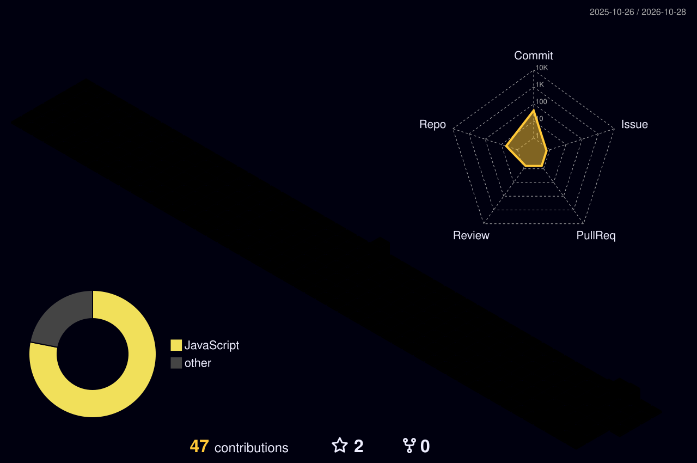

  

  

  

    
    
    
    
    
  

  

    <i>Curious by nature, I enjoy exploring new ideas, experimenting with technology, and learning through building.</i> 
    I'm pursuing a <b>BE in Artificial Intelligence &amp; Data Science</b>, and this is where I share projects and things I learn along the way.
  

<h2 align="center">
  
  Skills &amp; Tools
</h2>

  

<h2 align="center">
  
  Contributions
  
</h2>

  
  
  

<h2 align="center">
  
  GitHub Activity
  
</h2>

<picture>
  <source media="(prefers-color-scheme: dark)" srcset="https://raw.githubusercontent.com/abdulhafeef/abdulhafeef/output/github-contribution-grid-snake-dark.svg">
  <source media="(prefers-color-scheme: light)" srcset="https://raw.githubusercontent.com/abdulhafeef/abdulhafeef/output/github-contribution-grid-snake.svg">
  
</picture>

  <i>Thanks for visiting &mdash; let's keep building and learning together.</i>

  Template design inspired by <a href="https://github.com/zyh3699">© Zephyr Zhong (zyh3699)</a>

